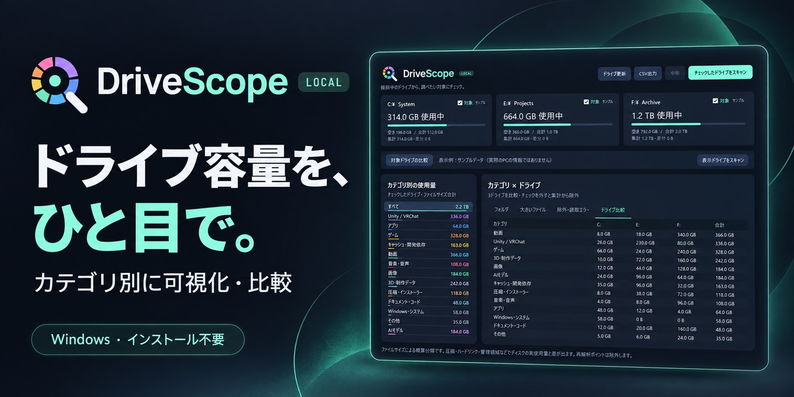
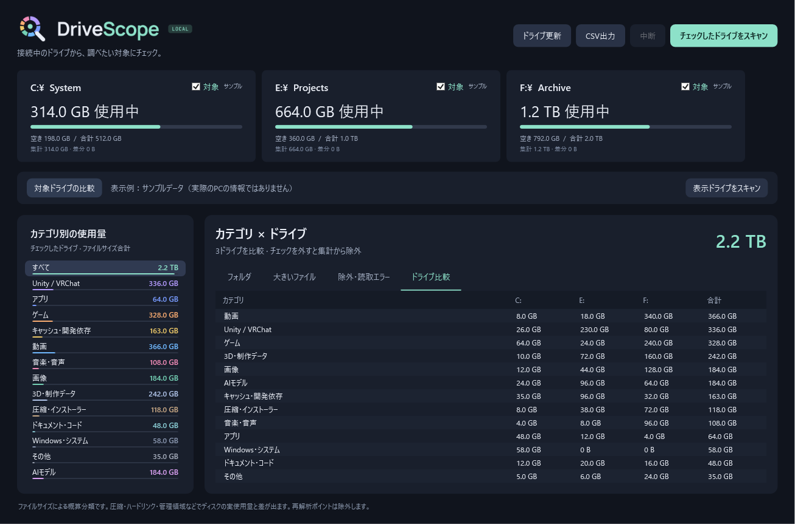

<picture>
  <source media="(prefers-color-scheme: dark)" srcset="assets/branding/drivescope-logo-local.svg">
  
</picture>

# DriveScope

接続中のドライブを自動検出し、**何に容量を使っているかをカテゴリ別に比較できるWindowsアプリ**です。調べたいドライブにチェックを付けるだけで、フォルダの内訳や大きいファイルを確認できます。

Unity / VRChatのプロジェクト、ゲーム、キャッシュ、AIモデルなども分類します。インストール不要で、ファイルの削除・移動機能や外部送信機能はありません。

## アプリ画面



ロゴ適用後のアプリから撮影した表示例です。容量・ドライブ名はサンプルデータで、実際のPCの情報は含みません。チェックしたドライブをカテゴリごとに横並びで比較できます。

## ダウンロード・起動

**[DriveScope-portable.zip をダウンロード](https://github.com/bassmicrobe/DriveScope/releases/latest/download/DriveScope-portable.zip)**

最新版は[GitHub Releases](https://github.com/bassmicrobe/DriveScope/releases/latest)から取得できます。リリースページでは変更内容も確認できます。

1. ZIPを任意のフォルダに解凍します。
2. `DriveScope.exe` を起動します。`DriveScope.exe.config` はexeと同じフォルダに置いてください。
3. 調べたいドライブの「対象」にチェックを付け、「チェックしたドライブをスキャン」を押します。

別のPCでも同じZIPを解凍して利用できます。移動先のドライブを自動検出し、設定や集計結果はそのPCに保存します。ZIPには集計結果や個人設定を含めていません。

### 動作環境

- Windows 10 / 11の64ビット版
- .NET Framework 4.8

.NET SDK、Python、Node.jsのインストールは不要です。

## 主な機能

| 機能 | 内容 |
| --- | --- |
| ドライブ選択 | ローカル・リムーバブルドライブなどから対象を選び、選択内容を保存 |
| 接続・取り外しの検出 | 約3秒ごとに一覧を更新。手動の「ドライブ更新」にも対応 |
| カテゴリ比較 | 選択したドライブを横並びで表示。台数に応じて列が増減 |
| フォルダの内訳 | 子孫を含めたサイズを表示し、ダブルクリックで掘り下げ |
| 大きいファイル | 容量順の一覧から、エクスプローラーで保存場所を確認 |
| 中断・結果の保存 | 途中結果を保存し、次回起動時に表示 |
| CSV出力 | Excelで開けるUTF-8 BOM付きCSVとしてカテゴリ・フォルダ・ファイルを出力 |

### カテゴリ

Unity / VRChat、アプリ、ゲーム、キャッシュ・開発依存、動画、音楽・音声、画像、3D・制作データ、圧縮・インストーラー、ドキュメント・コード、Windows・システム、AIモデル、その他の13種類です。

分類はパスと拡張子から判断します。たとえばUnityプロジェクト内の画像は「Unity / VRChat」、Libraryやnode_modulesは「キャッシュ・開発依存」、Program Files内の素材は「アプリ」に含まれます。AIモデルは `.gguf`、`.safetensors`、`.onnx` などを分類します。

## 使い方

- **ドライブを比較する:** 起動画面の「ドライブ比較」で、チェックしたドライブの内訳を確認します。
- **詳細を見る:** ドライブのカードや左のカテゴリをクリックします。フォルダをダブルクリックすると中へ進み、「↑ 上へ」で戻れます。
- **保存場所を開く:** フォルダ・ファイルを選び「エクスプローラーで表示」を押します。
- **最新の状態に更新する:** 対象を再スキャンします。起動時に表示される前回の結果は、ファイルの変更に自動追従しません。
- **途中で止める:** 「中断」を押します。ウィンドウを閉じる場合も、走査を中断して途中結果を保存します。

初回スキャンはファイル数により数分以上かかります。走査中も途中集計を確認できます。

### ドライブを増やしたり、取り外したりした場合

接続中のドライブに応じてカードと比較表の列が変わります。カードが画面に収まらない場合は横にスクロールできます。追加・再接続を検出しただけでは自動スキャンしません。

取り外したドライブは集計から除外し、走査中なら中断します。「対象」のチェックを外した場合も、そのドライブの走査を中断します。すべてのチェックを外すこともできます。

選択内容はドライブ文字ごとに保存します。初めて検出したローカル・リムーバブルドライブは初期状態で選択され、ネットワークドライブと光学メディアは未選択です。ネットワークはWindowsにドライブ文字を割り当てたものが対象で、利用できないドライブやメディア未挿入のドライブはスキャンできません。

結果はディスクの識別情報ごとに保存します。同じドライブ文字に別のディスクを接続しても、以前のディスクの集計を再利用しません。識別情報を取得できない場合、結果の表示はそのセッション中に限られます。

## 容量の算出方法と制限

**カテゴリの容量は、ファイルの論理サイズを合計した概算です。** ドライブカードにはWindowsから取得した実使用量・空き容量も表示します。

圧縮、スパースファイル、ハードリンク、ファイルシステムの管理領域、読み取れない領域などの影響で、カテゴリ合計と実使用量は一致しない場合があります。カードの「差分」は未走査領域だけを表すものではありません。ハードリンクは別パスごとに数えます。

- シンボリックリンク、ジャンクション、クラウドのプレースホルダーなどの再解析ポイントは、ファイル・フォルダともに除外します。
- 対象ファイルの内容は開かず、名前・属性・サイズを調べます。クラウド上のデータを取得するために開くことはありません。
- 読み取れないパスは除外一覧に記録します。表示する理由はドライブごとに最大1,000件です。
- 大きいファイルは、ドライブごと・カテゴリごとの上位100件から最大300件を表示します。検索もその一覧内で行うため、全ファイル検索ではありません。
- フォルダ一覧は選択階層の直下フォルダを表示します。直下のファイルはフォルダ一覧には表示せず、階層の合計には含めます。

管理者権限が必要なパスを調べたい場合は、exeを右クリックして「管理者として実行」から再スキャンできます。

## 保存先

結果と設定は、実行ユーザーの `%LOCALAPPDATA%\DriveScope` に保存します。

| ファイル | 内容 |
| --- | --- |
| `〈ドライブ文字〉_〈識別情報のハッシュ〉.scan.gz` | カテゴリ合計、フォルダ集計、上位ファイルのパス、除外理由 |
| `selection.txt` | ドライブ文字ごとの選択内容 |

このフォルダを削除すると保存済みの結果と設定をリセットできます。アプリ本体のフォルダを別のPCへコピーしても、これらのデータはコピーされません。

## ソースからビルド

Windows付属のC#コンパイラとWPFを使用します。追加パッケージの復元は不要です。ビルド前に、このリポジトリのフォルダから起動したDriveScopeを終了してください。

```powershell
git clone https://github.com/bassmicrobe/DriveScope.git
cd DriveScope
.\build.ps1
Start-Process .\DriveScope.exe
```

生成される `DriveScope.exe` はリポジトリのルートに置かれます。実行時には同じフォルダの `DriveScope.exe.config` も使用します。

### 配布ZIPを作成

```powershell
.\package.ps1
```

ビルドとセルフテストを実行し、成功すると `dist/DriveScope-portable.zip` を更新します。ZIPにはexe、設定ファイル、README、LICENSEとREADME表示用のロゴ・画面画像を含めます。アプリ用のアイコンと画面内ロゴはexeに埋め込んでいるため、外部の画像ファイルがなくても起動できます。ソースを変更して配布するときは、ZIPもこのコマンドで更新してください。

### 検証

セルフテストは小さなテスト用ファイルを作成し、分類、バイト数の集計、長いパス、中断、結果の保存、CSV、ドライブの追加・取り外し、選択内容の保存などを確認します。ドライブ全体のスキャンは行いません。

```powershell
# package.ps1からも実行されるセルフテスト
$reportDirectory = Join-Path $PWD 'artifacts\verification'
$testProcess = Start-Process .\DriveScope.exe -ArgumentList @(
    '--self-test', ('"' + $reportDirectory + '"')
) -WindowStyle Hidden -Wait -PassThru
$testProcess.ExitCode
Get-Content (Join-Path $reportDirectory 'self-test.txt')
```

終了コード `0` が成功です。検証用の生成物は `artifacts` に保存し、Git管理の対象から除外しています。

保存済みの実ドライブの結果を使った画面検証もできます。あらかじめアプリでスキャンしてから終了し、次を実行してください。

```powershell
Start-Process .\DriveScope.exe -ArgumentList @(
    '--verify-ui', ('"' + $reportDirectory + '"')
) -WindowStyle Hidden -Wait
Get-Content (Join-Path $reportDirectory 'ui-test.txt')
```

画面検証のレポートや画像には実際のPCのドライブ情報・ファイルパスが含まれるため、配布ZIPには含めていません。

周期更新の回帰テストは `--verify-refresh` で実行できます。約10秒間、自動更新中に一覧・行の選択・背景ブラシが作り直されないことを確認し、その後に値の更新が既存のセルへ反映されることを検証します。

```powershell
Start-Process .\DriveScope.exe -ArgumentList @(
    '--verify-refresh', ('"' + $reportDirectory + '"')
) -WindowStyle Hidden -Wait
Get-Content (Join-Path $reportDirectory 'refresh-test.txt')
```

READMEの画面画像は、アプリを終了した状態で次のコマンドから再生成できます。このモードでは実ドライブや保存済みの集計結果・選択設定を読み込まず、サンプルデータだけを表示します。

```powershell
Start-Process .\DriveScope.exe -ArgumentList @(
    '--docs-screenshot', ('"' + (Join-Path $PWD 'assets\screenshots\drivescope-overview.png') + '"')
) -WindowStyle Hidden -Wait
```

### 構成

```text
assets/branding/           元のSVGロゴ・派生PNG・Windows用ICO
assets/screenshots/        README用のアプリ画面（サンプルデータ）
src/
  App.cs                 画面操作・集計表示
  MainWindow.xaml        WPFの画面定義
  DriveManagement.cs     ドライブ検出・識別・選択保存
  Scanner.cs             ファイル走査・分類・集計・結果保存
  Verification.cs        セルフテストと画面検証
  ViewRows.cs            行の差分更新・変更通知
  PresentationVerification.cs  表示更新の回帰テスト・公開用サンプル表示
  app.manifest           実行権限・長いパスへの対応
DriveScope.exe.config    .NET Frameworkの実行設定
build.ps1                ビルド
package.ps1              ビルド・テスト・ZIP作成
tools/render-branding.cjs  SVGからPNG・複数サイズのICOを再生成
dist/                    配布用ZIP
```

アプリアイコンにはダーク版、画面ヘッダーにはLOCAL付きの横長ロゴを使用しています。READMEは表示テーマに応じてダーク背景用・明るい背景用のSVGを切り替えます。元のSVGは `assets/branding` に保存しています。派生画像を再生成する場合のみ、Node.jsと`sharp`を導入した開発環境で `node tools/render-branding.cjs` を実行してください。通常のビルドやアプリの実行には不要です。

変更時は `package.ps1` による検証を行い、UIを変更した場合は画面表示も確認してください。不具合の報告にはWindowsのバージョン、ドライブの種類、再現手順を添えると調査しやすくなります。

## ライセンス

[MIT License](LICENSE)
